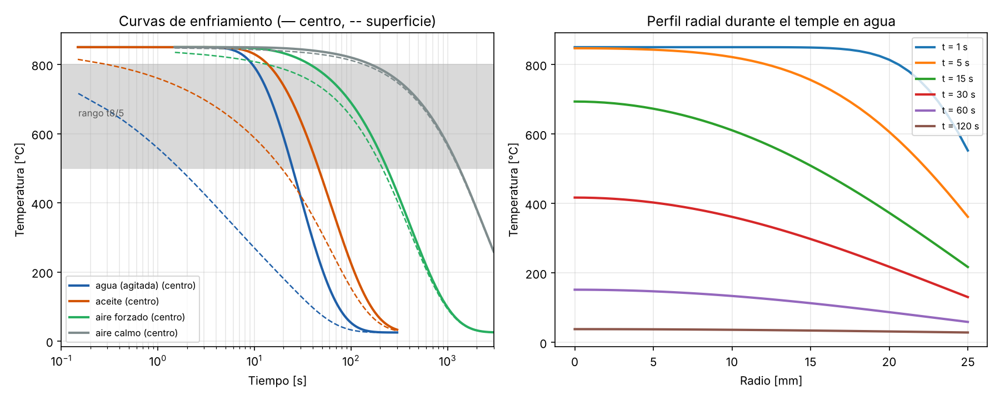

# Temple de ejes de acero — conducción transitoria por diferencias finitas

Modelo numérico del enfriamiento de un eje de acero cuando se templa desde 850 °C en agua, aceite o aire. Lo hice para conectar dos cursos que normalmente se ven por separado: **transferencia de calor** (Ingeniería Civil) y **tratamientos térmicos** (Ingeniería Metalúrgica). La pregunta de fondo es simple: *¿por qué un eje grueso templado en aceite no queda igual de duro en el centro que en la superficie?*



## Modelo

Cilindro largo con simetría radial:

```
∂T/∂t = α (∂²T/∂r² + (1/r)·∂T/∂r)          0 < r < R
∂T/∂r = 0                                   r = 0 (centro)
−k·∂T/∂r = h·(T − T∞)                       r = R (superficie)
```

- Esquema **explícito** (FTCS) con paso de tiempo calculado automáticamente según el criterio de estabilidad, incluyendo el efecto del número de Biot en la celda de borde.
- En el centro se usa el límite `(1/r)·∂T/∂r → ∂²T/∂r²`, así que el laplaciano se vuelve `2·∂²T/∂r²`.
- La convección se impone con un **nodo fantasma** fuera de la superficie.

Cada medio de temple se representa con un coeficiente de convección efectivo `h` (agua agitada ≈ 5000, aceite ≈ 1200, aire forzado ≈ 150, aire calmo ≈ 25 W/m²·K).

## Resultados para un eje de Ø50 mm

```
Medio            h [W/m²K]  t8/5 sup [s]  t8/5 centro [s]  ΔT máx [°C]
agua (agitada)        5000           1.6             15.3          525
aceite                1200          18.8             32.3          253
aire forzado           150         197.3            198.3           47
aire calmo              25        1158.9           1158.9            8
```

- **t8/5** es el tiempo que tarda el material en pasar de 800 a 500 °C, la zona donde la austenita se transforma. Mientras más corto, más probable es obtener martensita (dura); si es largo, se forman perlita o bainita.
- En agua, la superficie cruza esa zona en ~2 s pero el centro tarda ~15 s: casi 10 veces más. Eso explica el **gradiente de dureza** entre superficie y núcleo en piezas gruesas, y por qué la templabilidad (ensayo Jominy) importa tanto al elegir el acero.
- La diferencia de temperatura máxima entre centro y superficie en agua supera los 500 °C. Ese gradiente es el origen de las **tensiones residuales** y de las fisuras de temple, y es la razón por la que muchos aceros aleados se templan en aceite aunque enfríe más lento.
- En aire calmo el eje se enfría prácticamente uniforme (Bi ≈ 0.02), que es lo que se busca en un **normalizado**.

## Validación

| Prueba | Criterio |
|---|---|
| Solución analítica exacta (serie de Bessel, cilindro infinito) para h = 25, 1200 y 5000 W/m²K | Error < 2 °C en centro y superficie |
| Límite de capacitancia concentrada (Bi ≪ 0.1) | Coincide con T = T∞ + ΔT·e^(−t/τ) con error < 1 % |
| Coherencia física | La superficie siempre está más fría que el centro |

```bash
pip install -r requirements.txt
python -m pytest -q
python comparar_medios.py
```

## Simplificaciones (y cómo mejorarlas)

- Propiedades constantes: en realidad `k` y `cp` cambian con la temperatura, y `cp` tiene un pico en la transformación de fase.
- `h` constante: el temple en agua real pasa por etapas de película de vapor, ebullición y convección, con `h` muy distinto en cada una.
- No se calcula la microestructura final. Un siguiente paso natural sería acoplar las curvas de enfriamiento con un diagrama CCT y la ecuación de Koistinen–Marburger para estimar la fracción de martensita.

## Referencias

- Incropera, F. et al. *Fundamentals of Heat and Mass Transfer*, cap. 5.
- Totten, G. *Steel Heat Treatment: Metallurgy and Technologies*.
- Callister, W. *Ciencia e Ingeniería de los Materiales*, cap. 10–11.
